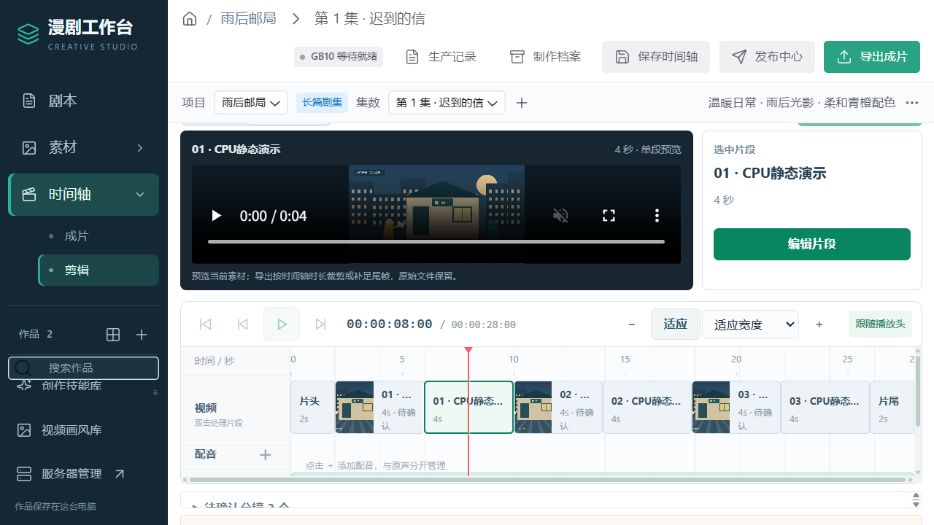
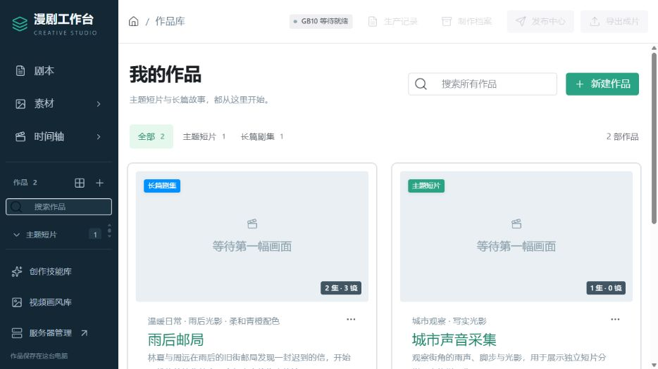
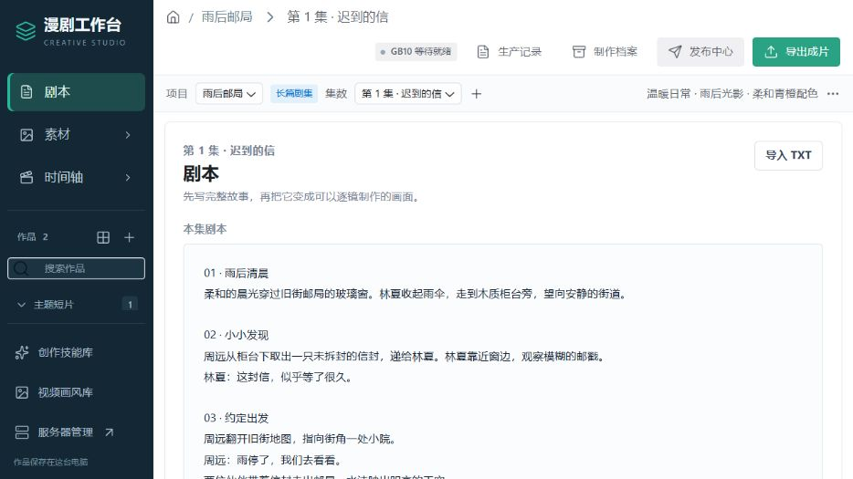
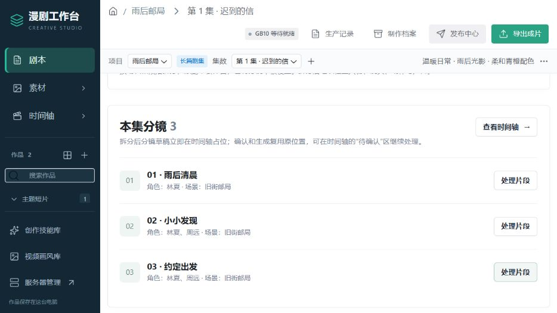
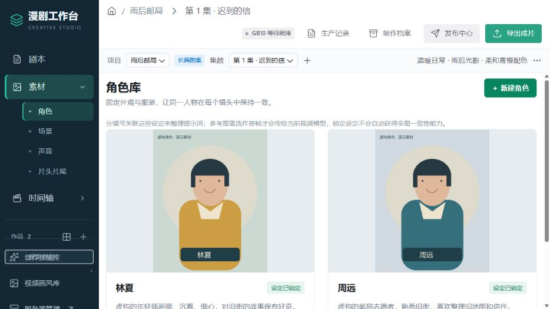
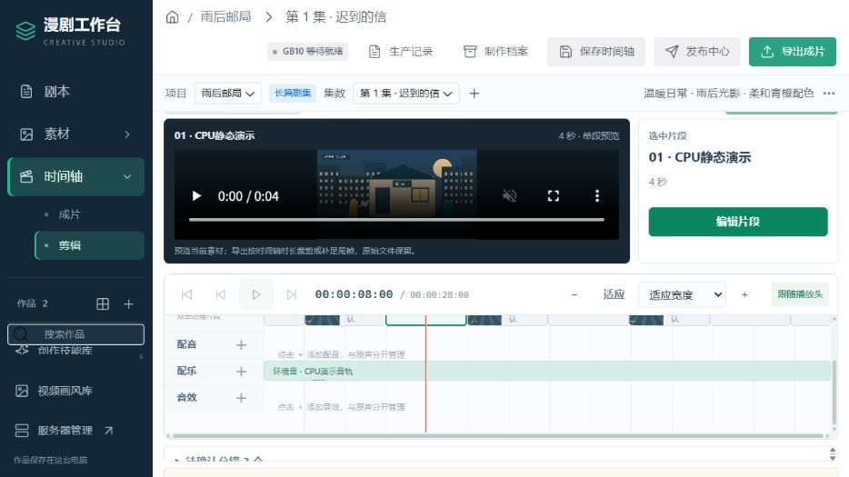

# 漫剧工作台 · 学习框架

一个本地优先的漫剧与短片制作工作台，将**作品与分集、剧本与分镜、参考素材、剪辑与音轨、生产任务和交付适配**放在同一套流程中。从故事拆成镜头，到整理角色和场景，再到时间轴预览与声音编排，可以围绕同一部作品持续制作。



本仓库是可独立阅读、构建和启动的脱敏源码版，保留 React 界面、本机 HTTP 服务、CLI、数据模块及外部能力适配。首次启动使用空白数据与独立端口，适合学习一个制作系统如何组织素材、编辑状态、任务与记录。

截图来自独立演示实例，作品「雨后邮局」与人物均为虚构。参考图为本地几何示意图，视频为 CPU 合成的静态演示片段，音轨也是本地合成示例；没有执行 GPU 生成、成片导出或平台发布。截图展示真实界面与编排操作，不代表 AI 出片效果。首次启动的仓库不包含这些演示作品。

## 主要功能

| 制作环节 | 工作台提供的组织方式 |
| --- | --- |
| 作品与分集 | 主题短片、长篇剧集分类；作品检索；同作品下管理多集内容 |
| 剧本与分镜 | 编辑或导入剧本，按段落拆成草稿分镜，立即建立时间轴占位；逐镜整理画面、声音、时长与参考绑定 |
| 参考素材 | 角色、场景与声音库；保存固定特征和参考媒体；按镜头关联设定及首帧 |
| 剪辑与声音 | 片头片尾、分镜占位和导入媒体共用时间轴；片段预览、裁切、独立配音/配乐/音效轨、音量与淡入淡出 |
| 生产任务 | 保存视频、声音等任务的参数、状态、版本和生产记录；通过适配器接入外部执行能力 |
| 交付适配 | 保留本机合成、超分、发布和作品档案模块；实际使用需配置相应工具、设备与账号 |

### 作品库：短片与剧集分开组织

作品库按类型筛选，并显示分集数与分镜数。侧栏可以在作品之间切换，进入作品后再选择具体分集。示例同时包含两集的「雨后邮局」与独立短片「城市声音采集」。



### 剧本到分镜：故事与逐镜制作相连

先写完整故事，再按段落拆成可以逐镜处理的草稿。拆分采用确定的段落规则；文本创作由用户或对话助手完成，CLI 本身不带文本大模型。



草稿分镜拆分后立即出现在时间轴中，确认与生成沿用已有位置。每镜可以关联角色、场景和首帧，再通过「处理片段」继续整理制作资料与提示词。



### 素材库：让设定和参考跟着作品走

角色卡保存描述、固定特征、声音风格和参考图；场景卡保存环境与视觉设定。分镜可以引用这些资料，便于在多镜头、多分集中保持制作依据一致。参考图只有在明确绑定为首帧时才会送入当前视频模型，锁定设定本身不保证模型生成一致。



### 时间轴与音轨：把素材组织成片段顺序

顶部示例展示选中片段的原生视频预览，以及片头、草稿分镜、导入视频和片尾的位置。导入视频与生成任务分别保留来源，CPU 演示视频按普通媒体入轨，不产生虚假的生成记录。

声音独立分为配音、配乐和音效轨，可设置开始时间、裁切、音量、循环、淡入淡出及分段音量变化。下图将合成示例音频放入配乐轨，用于展示跨片段编排；画面原声和独立音轨可以分别管理。



## 快速开始

需要 Node.js 22.12 或更新版本及 npm。仓库为 Public，可直接查看和克隆：

```sh
git clone https://github.com/chinnkenni/toon-workbench-framework.git
cd toon-workbench-framework
npm ci
npm run build:studio
npm test
npm start
```

打开 [本地工作台](http://127.0.0.1:18990/)。首次启动创建本副本自己的 `data/`，页面没有已有作品。按 `Ctrl+C` 停止本终端启动的学习实例。

`npm ci` 安装前端依赖；构建输出位于本副本的 `public/studio-ui/`。测试使用离线防护，阻止网络与进程启动。请勿用生产目录的数据替换学习实例的空白数据。

### 外部能力与配置

源码保留视频、配音、配乐、转写、超分和发布的核心适配器。这些入口需要自行部署相应的媒体工具、模型、设备或平台应用；仅安装本仓库不会自动提供 GPU 生成能力。接入方法与依赖边界见 [配置说明](docs/CONFIGURATION.md)。

仓库不含个人作品、运行配置、账号凭据、证书、NAS 档案、模型权重、媒体引擎、第三方技能包或参考图库。

### 可选入口

| 入口 | 命令 | 本机端口 |
| --- | --- | --- |
| 学习工作台 | `npm start` | 18990 |
| 空白服务器监控 | `npm run start:monitor` | 18987 |
| 进阶服务宿主 | `npm run start:advanced` | 18991 |

常规学习使用 `npm start` 即可。监控可在另一个终端单独启动。进阶宿主会监督并按需启动工作台和监控；使用它时先停止本副本已经启动的相同服务。未安装的媒体引擎会显示不可用。

这些默认端口与原服务隔离。不要改成其他现有实例的端口，也不要把 CLI 指向其他实例。

## CLI 入门

无需全局安装命令。请使用本副本的 npm 入口，不要执行 `npm link` 覆盖其他实例已经安装的 `toon`：

```sh
npm run cli -- help --local --json
npm run cli -- schema work create --local --json
npm run cli -- work list --local --studio-url http://127.0.0.1:18990 --json
```

`help` 与 `schema` 可用于先读命令和输入结构。操作作品前先列出本实例的作品，使用返回的编号；写入后读回。生成、导出、发布等命令有实际副作用，学习接口结构时使用 `schema` 或命令支持的 `--dry-run`。包的命令名为 `toon-framework`，与原 `toon` 分开；配对配置也使用独立的 `.toon-workbench-framework/remote` 目录。

## 建议学习顺序

1. 阅读 [架构说明](docs/ARCHITECTURE.md)，找到前端、HTTP 路由与数据模块的关系。
2. 启动空白工作台，创建自己的练习作品，再观察 `works.mjs`、`studio.mjs` 和 CLI 的请求结构。
3. 阅读 `public/timeline-transport.js`、`public/timeline-preview.js` 与对应测试，理解片段选择、播放头和预览有效性。
4. 阅读 [配置说明](docs/CONFIGURATION.md)，按需接入自己的媒体工具或设备。
5. 分享前阅读 [GitHub 分享步骤](docs/GITHUB-SHARING.md) 与 [第三方说明](THIRD_PARTY_NOTICES.md)。

本框架以 [Public 仓库](https://github.com/chinnkenni/toon-workbench-framework) 分享脱敏源码，任何人都可查看和克隆。框架尚未指定开源许可证；如需再分发或将代码用于其他项目，请先与维护者明确许可范围。运行数据、账号和真实设备配置不属于仓库内容。
