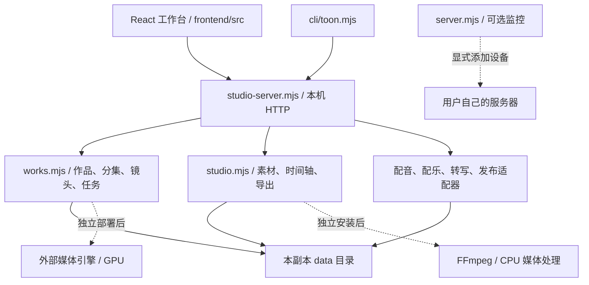

# 架构与代码阅读

系统把作品编排、外部计算和发布适配分开。学习副本从空白本地状态启动；外部能力没有自动接通。

## 主要模块

| 路径 | 阅读重点 |
| --- | --- |
| `frontend/src/App.jsx` | 工作台入口、作品切换、弹窗与状态协调 |
| `frontend/src/LegacyWorkspace.jsx`、`public/studio-panels.js` | React 与已有编辑界面的衔接 |
| `studio-server.mjs` | 本机访问保护、静态资源、作品 API 与各模块挂接 |
| `works.mjs` | 作品目录、剧本、分镜、生成任务、选版与持久化 |
| `studio.mjs` | 素材、时间轴、片头片尾和导出请求 |
| `public/timeline*.js` | 时间轴交互、播放器控制和预览过期判断 |
| `timeline-renderer.mjs` | 素材解析、剪辑计划、合成参数与导出校验 |
| `h3-execution.mjs`、`production-cues.mjs` | 执行稿与制作资料的版本、校验及快照 |
| `tts.mjs`、`music.mjs`、`asr.mjs`、`ai-upscale.mjs` | 外部能力边界、任务与产物证据 |
| `production-log.mjs`、`generation-telemetry.mjs` | 生产记录、实测指标和来源快照 |
| `publishing*.mjs`、`work-archive.mjs`、`lan-*.mjs` | 可选发布、档案和局域网接入 |
| `cli/commands.mjs`、`cli/toon.mjs` | 命令定义、schema、请求验证与服务寻址 |
| `tests/` | 可在离线防护下运行的单元测试 |

工作台是作品目录的唯一 HTTP 写入口。不要让两个实例共用同一个 `data/`，也不要通过共享文件夹让多台电脑同时写目录。学习实例的默认地址为 `http://127.0.0.1:18990`，可选监控为 18987，宿主为 18991。

## 一次操作的数据流

前端或 CLI 校验输入并发送请求；路由定位作品和分集；业务模块核对版本与归属；保存状态后返回当前对象。需要异步执行时先登记任务，再由适配器提交并记录结果。产物应保留来源、参数、状态与完整性证据；缺少的历史指标不能补造。

`npm start` 通过 `tools/start-learning.mjs` 创建学习工作台，使用本副本数据目录和空发布适配器。`service-host.mjs` 是进阶入口，会管理它启动的子服务；初学者不必使用。

技能目录与全局图库在本副本中为空。技能路由、媒体管理和适配器结构仍可供学习，但没有附带第三方原文、示例图片、模型或可用生成后端。UI 中保留的能力入口不代表依赖已经安装。
